# Forever Loot Tracker

**Session-based loot and money tracker for WoW Forever.**

Keep a clean record of what you pick up, craft, buy, and earn — with sources, filters, and exports — without digging through chat scrollback.

**CurseForge:** [forever-loot-tracker](https://www.curseforge.com/wow/addons/forever-loot-tracker)  
**GitHub:** [Westfall-Digital/ForeverLootTracker](https://github.com/Westfall-Digital/ForeverLootTracker)

Inspired by the WildStar classic [FSLootTracker](https://github.com/NexusInstruments/FSLootTracker).

---

## Screenshots

### Items
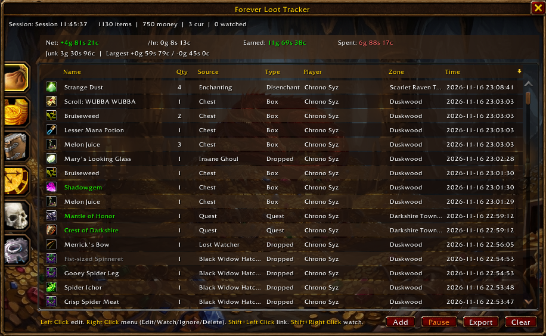

### Money Log
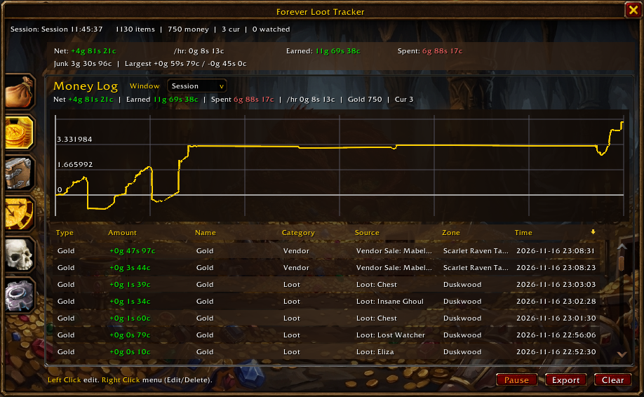

### Watch list
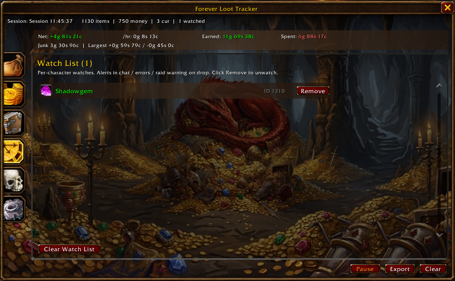

### Objective Tracker (Watched Loot)
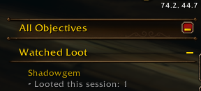

### Export
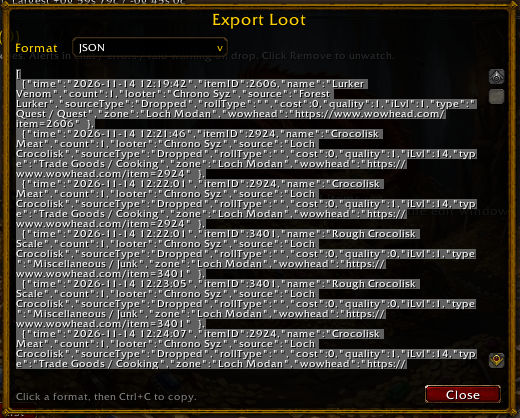

### Sessions
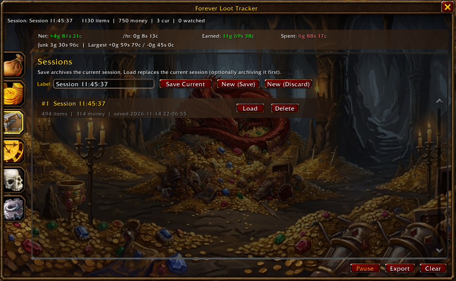

### Edit item
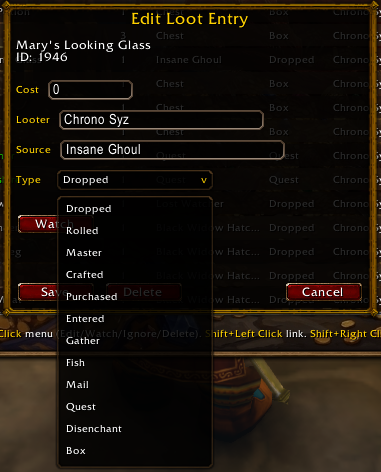

### Ignore rules
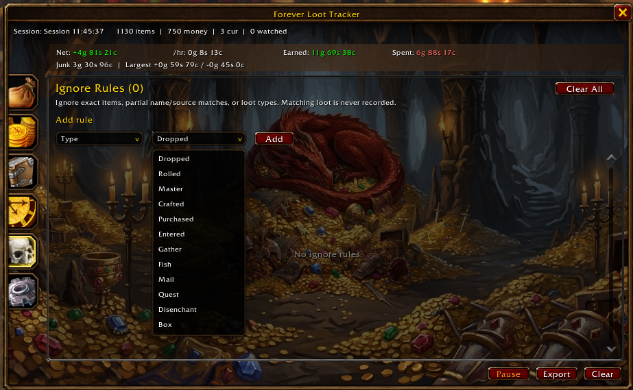

### Options
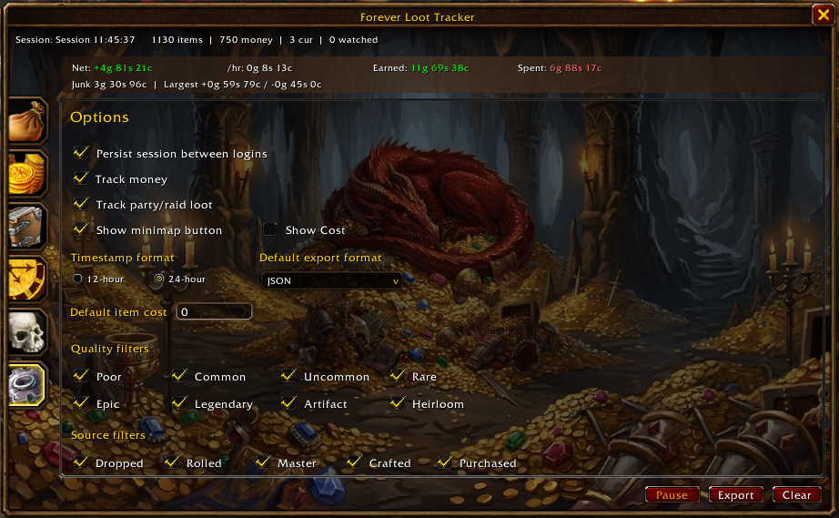

### Minimap button
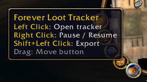

### Titan Panel
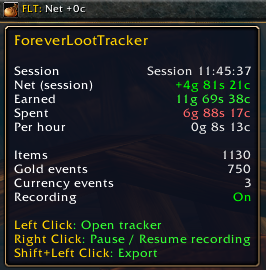

---

## Features

### Loot tracking
- Logs items you receive during a session (personal loot, rolls, crafts, vendor buys, mail, quest rewards, and more)
- Tags entries with a likely **source** (mob / encounter, profession, vendor, mailbox, quest, disenchant, etc.)
- Quality filters plus flexible **ignore** and **watch** rules (by item, name, source, or type)
- Edit cost and looter per row; add items manually when needed
- Optional Objective Tracker integration for watched loot

### Money & currency
- Tracks gold gains and spends (loot, vendor, repair, flight, auction, mail, trade, and similar)
- Cumulative **money chart** with windowed views (30m / 1h / 2h / 4h / full session)
- Session stats: total, per hour, average, largest gain, junk sell value
- Currency gains captured alongside loot where available

### Sessions & export
- Save, restore, and manage named sessions
- Export your data as **CSV**, **JSON**, **BBCode**, or **HTML**

### UI extras
- Minimap button (and Addon Compartment support)
- Optional **Titan Panel** plugin when Titan is installed
- Compact, readable tracker window built for Forever (`Interface 16001`)

---

## Commands

| Command | Action |
| --- | --- |
| `/flt` · `/foreverloot` · `/floot` | Toggle the tracker window |
| `/flt clear` | Clear the current session |
| `/flt export` | Open the export window |
| `/flt debug` | Toggle debug chat output |

---

## Quick tips

- **Left-click** a row to edit cost / looter (or delete)
- **Right-click** to ignore that item
- **Shift-right-click** to toggle watch
- **Shift-click** to link the item in chat

---

## Notes

- Built specifically for **WoW Forever**. Combat-log APIs are restricted on Forever, so source attribution uses encounter events and readable unit names instead of CLEU.
- Bank / guild-bank bag moves are **not** tracked as loot.
- Optional dependency: Titan Panel (for the Titan plugin). LibStub and LibGraph are bundled.

---

## Support

- CurseForge: [forever-loot-tracker](https://www.curseforge.com/wow/addons/forever-loot-tracker)
- Issues & source: [GitHub — Westfall-Digital/ForeverLootTracker](https://github.com/Westfall-Digital/ForeverLootTracker)
