# Forever Loot Tracker

Session-based **loot and money tracker** for **WoW Forever** (`Interface: 16001`).

**CurseForge:** [forever-loot-tracker](https://www.curseforge.com/wow/addons/forever-loot-tracker)  
**Source:** [Westfall-Digital/ForeverLootTracker](https://github.com/Westfall-Digital/ForeverLootTracker)

Functional recreation of the WildStar addon [FSLootTracker](https://github.com/NexusInstruments/FSLootTracker).

> CurseForge listing copy is maintained in [`DESCRIPTION.md`](DESCRIPTION.md) (paste that file into the CurseForge description editor when it changes).

## Screenshots

### Items
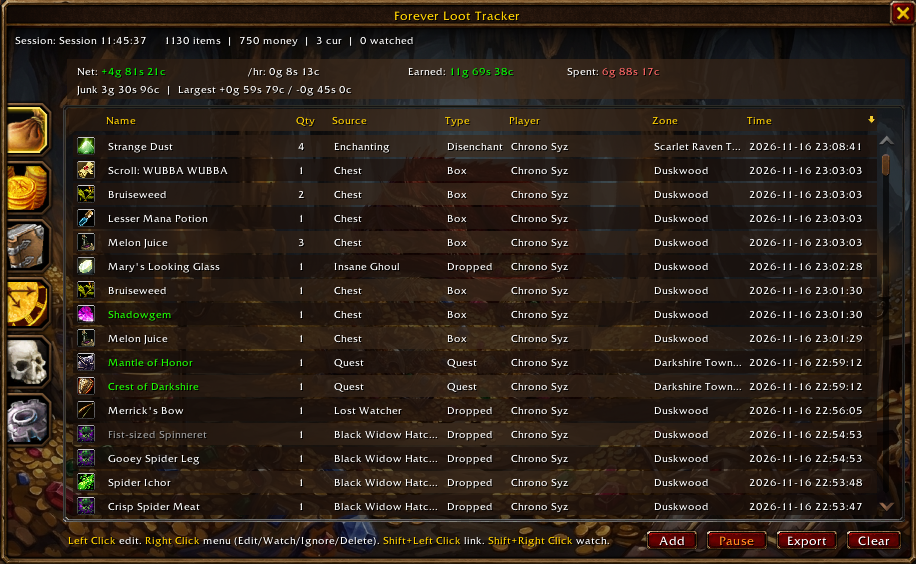

### Money Log
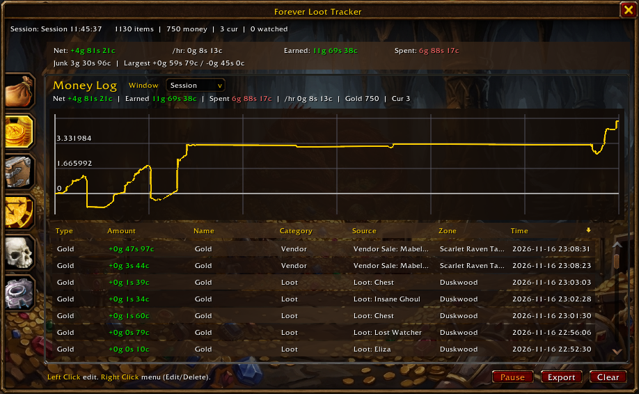

### Watch list
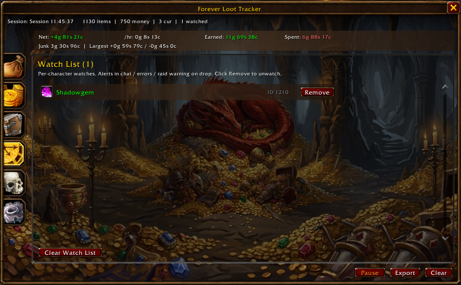

### Objective Tracker (Watched Loot)
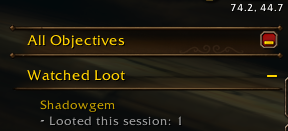

### Export
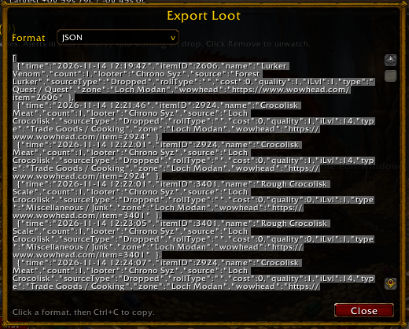

### Sessions
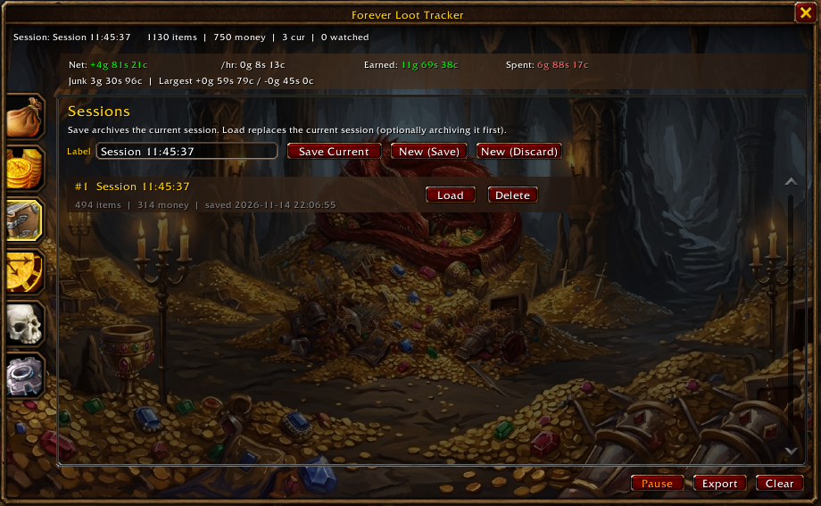

### Edit item
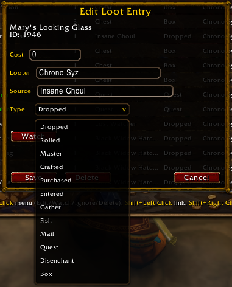

### Ignore rules
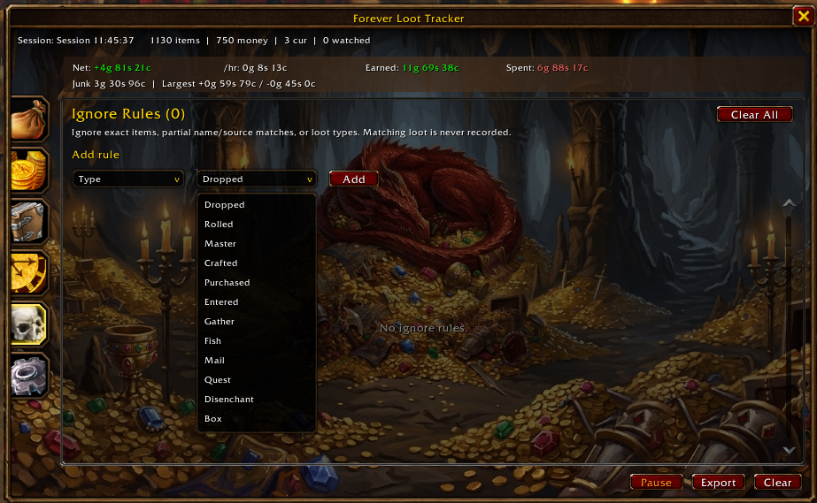

### Options
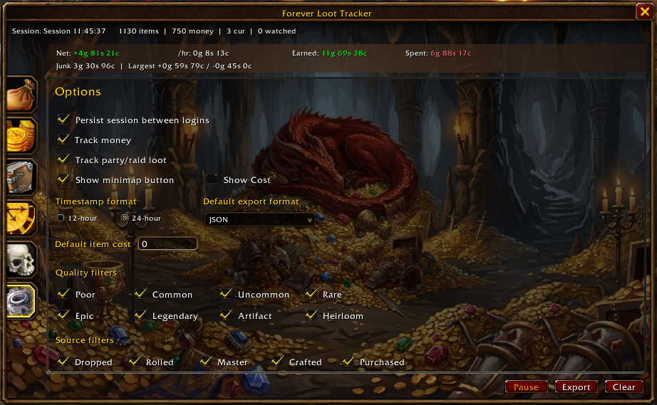

### Minimap button
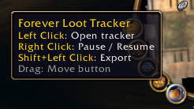

### Titan Panel
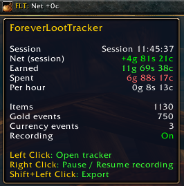

## Features

- Captures personal and party/raid loot, crafts, vendor buys, mail, quest rewards, and more
- Tags entries with a likely **source** (encounter / target, profession, vendor, mailbox, quest, disenchant, …)
- Quality filters plus flexible **ignore** and **watch** rules
- Money gains/spends with cumulative chart and session stats
- Currency tracking where available
- Save / restore sessions; export **CSV**, **JSON**, **BBCode**, **HTML**
- Minimap button, optional Titan Panel plugin, Objective Tracker “Watched Loot”

## Commands

| Command | Action |
| --- | --- |
| `/flt` `/foreverloot` `/floot` | Toggle tracker window |
| `/flt clear` | Clear current session |
| `/flt export` | Open export window |
| `/flt debug` | Toggle debug chat |

## UI tips

- **Left-click** a row → edit cost / looter (or delete)
- **Right-click** → ignore that item
- **Shift-right-click** → toggle watch
- **Shift-click** → insert item link into chat

## Development notes

Forever blocks addon combat-log access, so kill/source attribution uses encounter events and readable `target` / `mouseover` names instead of CLEU. Bank transfers are not tracked as loot.

A local `_wildstar_ref/` tree may exist for porting reference; it is gitignored and never shipped.
